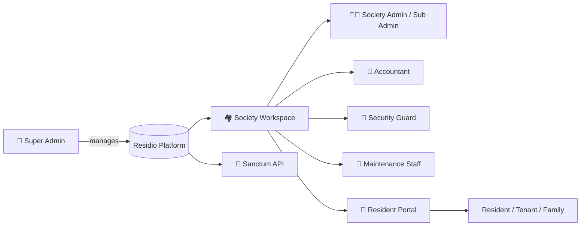

<div align="center">

# 🏘️ Residio

### The all-in-one platform for running residential societies & apartment communities

<p>
  
  
  
  
  
</p>

<p>
  
  
  
  
  
</p>

</div>

---

## 📖 About

**Residio** is a web app for managing residential societies and apartment communities. Every society gets its own workspace for managing **homes, residents, staff, visitors, finances, maintenance, and communications**, while residents get a separate **portal** for their own bills, notices, and messages.

On top of that there is a **Super Admin** workspace for operating the platform itself, and a **Sanctum-authenticated API** for client apps.

> 🎛️ What each person sees depends on their **role**, their **permissions**, and the society's **subscription plan**.

---

## ✨ Features

### 🏠 Society Setup & People
| Module | What it does |
|---|---|
| 🏢 **Society Profile** | Name, city, state and location details used across the app |
| 🏗️ **Towers & Flats** | Buildings, floors and units, with unit scaffolding when creating a tower |
| 🅿️ **Parking Slots** | Track parking spaces and assignments |
| 📁 **Documents** | Upload and manage society documents |
| 👨‍👩‍👧 **Residents** | Resident records, family members, emergency contacts, exports |
| 📒 **Resident Directory** | Directory view with permission-based export |
| 🚗 **Vehicles** | Vehicles linked to resident accounts |
| 🧑‍🔧 **Staff** | Staff records, plus attendance, shifts, leave and payroll when enabled |

### 🛡️ Daily Operations
| Module | What it does |
|---|---|
| 🚪 **Visitors** | Visitor passes, approve/reject requests, gate console for check-in/out |
| 📣 **Complaints** | Open → Assigned → In progress → Resolved → Closed, with resident feedback |
| 🏊 **Facilities & Bookings** | Manage shared facilities; approve, reject or cancel bookings |
| 📌 **Notice Board** | Notices and polls that residents can view and vote on |
| 🧰 **Assets** | Track assets and categories, recalculate depreciation, schedule maintenance |
| 💬 **Building Group Chat** | Conversations tied to a specific building |

### 💰 Finance, Vendors & Support
| Module | What it does |
|---|---|
| 🧾 **Maintenance Management** | Maintenance heads, bill generation, dues, payments, waivers, invoices and receipts |
| 📚 **Accounting** | Accounts, bank/cash accounts, balanced journal entries, trial balance, P&L, balance sheet |
| 🤝 **Vendors & Work Orders** | Vendor records, contracts, payments, ratings, work-order tracking |
| 🎫 **Helpdesk** | Tickets, replies, assignment, escalation and closure |
| 📊 **Reports** | Operational and financial reports with export and print |

### 📡 Communication & Settings
- ✉️ **Direct messages, broadcasts and reusable templates**
- 🔔 **Resident Portal messaging** limited to conversation participants
- ⚙️ **General Settings**: currency, timezone, date format, support contact, and the **resident invite code**
- 🔐 **Roles & permissions matrix** that the society admin can adjust
- 👤 **Profile, password management and two-factor authentication**

### 🌐 Dashboards & Directory
- 📈 **Staff dashboard**: residents, units, occupancy, open complaints, today's visitors, pending dues, plus charts for collections, occupancy, visitors, complaints and facility usage
- 🙋 **Resident dashboard**: personal bills and documents, unread messages, recent announcements
- 🗺️ **Society Directory**: active societies with city/state filters (name and location only, no street address or contacts)
- 📍 **Societies near you**: dashboard preview matching city and state

### 🦸 Platform Administration (Super Admin)
Manage societies (suspend / impersonate), subscription plans and subscriptions, platform usage analytics, CMS pages and blog content, and contact inquiries.

---

## 🧭 How It Fits Together



---

## 🚀 Quick Start

### Requirements
- PHP and [Composer](https://getcomposer.org/)
- A database supported by Laravel (MySQL, SQLite, etc.)
- Node.js and npm, if the project builds front-end assets

### Install

```bash
# 1. Clone
git clone https://github.com/codedbydollys10/Residio.git
cd Residio

# 2. Install dependencies
composer install

# 3. Configure environment
cp .env.example .env
php artisan key:generate
# then set your database credentials in .env

# 4. Create tables and seed demo data
php artisan migrate --seed

# 5. (If the project uses compiled assets)
npm install && npm run build

# 6. Run it
php artisan serve
```

Open **http://127.0.0.1:8000** 🎉

### Run the tests

```bash
php artisan test
```

---

## 🔑 Demo Accounts

After seeding, these **local-only** accounts are available. All use the password **`Password@123`**.

| Role | Email | Login page |
|---|---|---|
| 🧑‍💼 Society Admin | `admin@greenvalley.test` | `/login` |
| 🧮 Accountant | `accountant@greenvalley.test` | `/login` |
| 💂 Security Guard | `guard@greenvalley.test` | `/login` |
| 🔧 Maintenance Staff | `maintenance@greenvalley.test` | `/login` |
| 🏡 Resident | `resident@greenvalley.test` | `/resident-login` |
| 🦸 Super Admin | `super@communityos.io` | `/login` (password in `SuperAdminSeeder`) |

> ⚠️ These credentials are for **local testing only**. Never use them in production.

---

## 🧑‍🤝‍🧑 Getting Started Guides

### 🏛️ Create a society
1. Go to `/register` or click **Start free trial** on the homepage.
2. Enter the society name, city and state, pick a plan, and add the administrator's name, email and password.
3. Submit. The society and admin account are created and you're signed in.

### 🛠️ Recommended first setup (Society Admin)
1. **Complete the Society Profile** (name, city, state).
2. **Set up Towers & Flats** so residents have valid homes to register into.
3. **Add people and staff**, and assign roles and permissions.
4. **Configure Settings** (currency, timezone, date format, support contact).
5. **Share the resident invite code** (found in General Settings).
6. **Enable your workflows**: define maintenance heads before generating bills, add facilities before bookings, add vendors before work orders.
7. **Review the dashboard and reports.**

### 🏡 Resident / Tenant registration
1. Get the **invite code** from your society admin.
2. Go to `/resident-register`.
3. Enter the code, choose **Owner** or **Tenant**, select your building and flat.
4. Enter name, phone, email and password, then submit.

The building and flat must exist in that society, and Owner registration is blocked if the flat already has an owner.

### 🚪 Where to sign in
| Who | URL |
|---|---|
| Society staff & admins | `/login` |
| Residents & tenants | `/resident-login` |
| Resident portal | `/resident-portal` |

---

## 👥 Roles & Permissions

| Role | Purpose |
|---|---|
| 🦸 **Super Admin** | Platform-wide administration |
| 🧑‍💼 **Society Admin** | Broad control within their society, including settings and access |
| 🛡️ **Sub Admin** | Delegated society administration |
| 🧮 **Accountant** | Billing and accounting |
| 💂 **Security Guard** | Visitor and gate operations |
| 🔧 **Maintenance Staff** | Assigned complaints and asset tasks |
| 🏡 **Resident** | Resident-facing functions |
| 🔑 **Tenant** | Resident-facing functions allowed for tenants |
| 👨‍👩‍👧 **Family Member** | Limited resident-side access |
| 🏪 **Vendor** | Vendor-side access |

The module and role configuration lives in `config/communityos.php`.

---

## 💳 Plans & Feature Gates

| Plan | Highlights |
|---|---|
| 🆓 **Free Trial** | 14 days, full feature catalog, up to 50 units |
| 🌱 **Starter** | Visitors, complaints, notices, billing, communication |
| 🚀 **Professional** | Adds facilities, assets, accounting, helpdesk, reports |
| 🏆 **Enterprise** | All configured modules, no unit/user/storage caps in the seed config |

A Super Admin can change plans and their features. If a module is missing from your navigation, it may be excluded by your **plan**, **role**, or **permissions**.

> 💸 Residio records bills and payments, but **online payment collection requires a separately configured payment gateway**.

---

## 🗂️ Project Layout

```text
Residio/
├── app/Http/Controllers/     # Auth, society modules, super admin
├── config/communityos.php    # Module, role and feature catalog
├── database/seeders/         # Demo society, super admin, subscription plans
├── resources/views/          # Blade views (dashboard, portal, auth, settings)
├── routes/web/               # Per-module routes (visitors, accounting, ...)
├── tests/Feature/            # Feature tests
└── README.md
```

---

## 🧪 Tech Stack

- **Backend:** Laravel (PHP)
- **Views:** Blade templates
- **Auth/API:** Laravel Sanctum, with optional two-factor authentication
- **Access control:** role and permission matrix plus subscription feature gates
- **Testing:** `php artisan test`

---

## 🤝 Contributing

1. Fork the repo
2. Create a branch: `git checkout -b feature/amazing-feature`
3. Commit your changes: `git commit -m "Add amazing feature"`
4. Push: `git push origin feature/amazing-feature`
5. Open a Pull Request

---

## 📄 License

Released under the **MIT License**. See [LICENSE](LICENSE) for details.

<div align="center">

Made with ❤️ by [@codedbydollys10](https://github.com/codedbydollys10)

⭐ If Residio helps you, give it a star!

</div>
