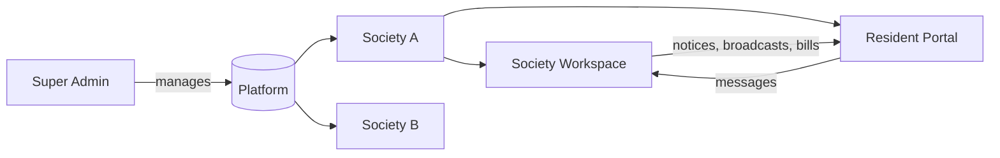

<div align="center">

<!-- Optional: add a logo at public/images/residio-logo.png and uncomment -->
<!--  -->

# 🏢 Residio

### One place to run a residential community.

A multi-tenant **society & apartment management** platform with a staff workspace,<br/>
a private resident portal, and a versioned REST API.

<br/>


<br/>

</div>

---

## ✨ Overview

Residio brings day-to-day community operations into one application: manage buildings and residents, handle visitor entry, publish notices, collect maintenance, coordinate repairs, manage facilities, and keep residents informed.

<table>
  <tr>
    <td width="25%" align="center">🏛️<br/><b>Society Workspace</b><br/><sub>Admins, committee, accountants, guards, maintenance staff</sub></td>
    <td width="25%" align="center">🏠<br/><b>Resident Portal</b><br/><sub>Bills, notices, broadcasts and messages with management</sub></td>
    <td width="25%" align="center">💬<br/><b>Building Group Chats</b><br/><sub>Conversations for residents in the same tower</sub></td>
    <td width="25%" align="center">🔐<br/><b>Multi-Tenant Security</b><br/><sub>Society records separated and access-controlled</sub></td>
  </tr>
  <tr>
    <td align="center">🔌<br/><b>Sanctum API</b><br/><sub>Authenticated clients at <code>/api/v1</code></sub></td>
    <td align="center">🧩<br/><b>Plan-Gated Modules</b><br/><sub>Features vary by subscription plan</sub></td>
    <td align="center">🛡️<br/><b>2FA &amp; Audit Trail</b><br/><sub>Two-factor auth, login history, audit logs</sub></td>
    <td align="center">🧪<br/><b>Demo Data</b><br/><sub>Seeded society and accounts for local testing</sub></td>
  </tr>
</table>

<!--
## 📸 Screenshots
Add screenshots to docs/screenshots/ and uncomment this section.

| Dashboard | Facilities | Resident Portal |
| :---: | :---: | :---: |
|  |  |  |
-->

---

## 🚪 Portals &amp; Access

| Portal | Who it's for | Sign-in route |
| :-- | :-- | :-- |
| 🏛️ **Society Workspace** | Society Admin, Sub Admin, Accountant, Security Guard, Maintenance Staff | `/login` |
| 🏠 **Resident Portal** | Residents, tenants, family members | `/resident-login` → `/resident-portal` |
| 📝 **Resident Registration** | New residents (invite code + valid building/flat required) | `/resident-register` |
| 🛠️ **Platform Admin** | Super Admin (societies, plans, subscriptions, CMS, analytics) | `/login` |



<details>
<summary><b>🏛️ Society Workspace details</b></summary>
<br/>

What each person can do depends on their role and permissions. Seeded roles: **Society Admin, Sub Admin, Accountant, Security Guard, Maintenance Staff, Resident, Tenant, Family Member, Vendor**.

The Society Admin can manage society settings, including the resident invite code, and administer the society's operations and people.

</details>

<details>
<summary><b>🏠 Resident Portal details</b></summary>
<br/>

Residents can access their own bills and bill documents, relevant notices, delivered broadcasts, and conversations they take part in. They can contact management through portal messages.

Authorization and tenant scoping are enforced **on the server as well as in the interface**. Residents only see records they are authorized to see; resident data is not a shared society-wide view.

> 💡 **Invite code:** a Society Admin can find it in **Settings → General Settings**.

</details>

<details>
<summary><b>🛠️ Platform Administration details</b></summary>
<br/>

The Super Admin workspace manages societies, subscription plans, subscriptions, platform analytics, CMS pages, blog content, and contact inquiries.

</details>

---

## 🧰 Features

<details open>
<summary><b>👥 Society &amp; People</b></summary>
<br/>

- Society profile and settings
- Tower/building, floor, and flat/unit management
- Parking slot management
- Society documents
- Resident, tenant, family-member, and staff records
- Resident directory, emergency contacts, and vehicles
- Role-based permissions for society teams

</details>

<details open>
<summary><b>🚧 Daily Operations</b></summary>
<br/>

- Visitor passes, approvals, check-in/check-out, and gate workflow
- Complaints with categories, assignment, status tracking, and SLA support
- Facility listings and bookings, including image URLs or uploaded images
- Notices, announcements, events, and polls
- Community assets and maintenance schedules
- Tower/building group conversations for residents in that building

</details>

<details open>
<summary><b>💰 Finance &amp; Administration</b></summary>
<br/>

- Maintenance heads, bill generation, invoices, receipts, collections, and due tracking
- Accounting ledgers, journal entries, and financial reports
- Vendor records, work orders, payments, and ratings
- Staff attendance, shifts, leave, and payroll
- Helpdesk tickets, replies, assignment, and escalation
- Society reports for operational and financial activity

</details>

<details open>
<summary><b>📣 Communication</b></summary>
<br/>

- Management-to-resident conversations
- Broadcasts and reusable communication templates
- Resident portal messages
- Building-specific group chats, with membership tied to the relevant building
- Notices and broadcasts surfaced in the portal according to their audience

</details>

<details open>
<summary><b>⚙️ Platform Controls</b></summary>
<br/>

- Multi-society administration
- Subscription plans and feature availability
- Role and permission management
- Two-factor authentication
- Audit and login history
- Tenant-scoped web and API access

</details>

> ℹ️ Some modules are gated by the society's subscription plan, so available modules and actions can vary by role and plan.

---

## 🧱 Technology Stack

| Area | Technologies |
| :-- | :-- |
| **Application** | PHP 8.2+, Laravel 12 |
| **Database** | SQLite (local development), MySQL/MariaDB supported |
| **Web interface** | Laravel Blade, Bootstrap 5, Bootstrap Icons |
| **Front-end behavior** | JavaScript, jQuery, DataTables, Chart.js |
| **API authentication** | Laravel Sanctum |
| **Queues & caching** | Laravel queues and cache (database drivers locally, Redis supported) |
| **File storage** | Laravel filesystem (local or S3-compatible) |
| **Asset tooling** | Vite, Tailwind CSS packages, npm (for `resources/` assets) |
| **Testing** | PHPUnit and Laravel feature tests |

> The web layout loads Bootstrap, icons, DataTables, Chart.js, and jQuery from CDNs. Application styles and scripts are served from `public/css` and `public/js`.

---

## 🚀 Quick Start

### Requirements

- ✅ PHP **8.2 or newer**
- ✅ Composer
- ✅ SQLite with the `pdo_sqlite` extension, **or** MySQL/MariaDB with the matching PDO extension
- ➕ Node.js and npm *(optional, only for Vite-managed `resources/` assets)*

### 1️⃣ Get the code

```bash
git clone https://github.com/codedbydollys10/Residio.git
cd Residio
composer install
```

### 2️⃣ Create your `.env`

This repository intentionally does **not** include an `.env.example`. Create a new `.env` in the project root:

```dotenv
APP_NAME=Residio
APP_ENV=local
APP_KEY=
APP_DEBUG=true
APP_URL=http://127.0.0.1:8000

DB_CONNECTION=sqlite
DB_DATABASE=database/database.sqlite

SESSION_DRIVER=database
CACHE_STORE=database
QUEUE_CONNECTION=database
MAIL_MAILER=log
```

> ⚠️ Never commit `.env`. It contains machine-specific configuration and secrets.

### 3️⃣ Prepare the database

<table>
<tr>
<td width="50%" valign="top">

**🪟 Windows (PowerShell)**

```powershell
if (-not (Test-Path database\database.sqlite)) {
    New-Item -ItemType File -Path database\database.sqlite | Out-Null
}
php artisan key:generate
php artisan migrate --seed
php artisan storage:link
```

</td>
<td width="50%" valign="top">

**🍎🐧 macOS / Linux**

```bash
touch database/database.sqlite
php artisan key:generate
php artisan migrate --seed
php artisan storage:link
```

</td>
</tr>
</table>

The seeder creates platform roles and plans, a **Green Valley** demo society, sample accounts, and module demo data. For an empty database without demo records, run `php artisan migrate` instead.

### 4️⃣ Run it

```bash
php artisan serve
```

Open **http://127.0.0.1:8000** 🎉

### 5️⃣ Sign in with demo accounts

All demo accounts share the local-only password: **`Password@123`**

| Role | Email | Sign-in |
| :-- | :-- | :-- |
| 🏛️ Society Admin | `admin@greenvalley.test` | `/login` |
| 💼 Accountant | `accountant@greenvalley.test` | `/login` |
| 💂 Security Guard | `guard@greenvalley.test` | `/login` |
| 🔧 Maintenance Staff | `maintenance@greenvalley.test` | `/login` |
| 🏠 Resident | `resident@greenvalley.test` | `/resident-login` |

> 🚨 **Development credentials only.** Change or remove them before deploying with real data. The demo resident is separate from the self-registration flow.
>
> A platform Super Admin is also seeded; its email is defined in [`SuperAdminSeeder.php`](./database/seeders/SuperAdminSeeder.php).

---

## 🔧 Optional Setup

<details>
<summary><b>🐬 Use MySQL or MariaDB</b></summary>
<br/>

Create an empty database, then update `.env`:

```dotenv
DB_CONNECTION=mysql
DB_HOST=127.0.0.1
DB_PORT=3306
DB_DATABASE=residio
DB_USERNAME=your_database_user
DB_PASSWORD=your_database_password
```

Then run:

```bash
php artisan migrate --seed
```

Keep database credentials in your local or deployment environment; never put real credentials in source control.

</details>

<details>
<summary><b>⚡ Build Vite-managed assets</b></summary>
<br/>

The standard Blade UI uses assets in `public/` and CDN libraries. If you change the Vite-managed files under `resources/`:

```bash
npm install
npm run build
```

For live development, run `npm run dev` in another terminal.

</details>

<details>
<summary><b>⏱️ Background jobs &amp; scheduled tasks</b></summary>
<br/>

For local development, process queued work in another terminal:

```bash
php artisan queue:work
```

`QUEUE_CONNECTION=database` stores queued jobs in the application database. In production, run a supervised queue worker and have Laravel's scheduler execute `php artisan schedule:run` every minute. Configure mail, storage, cache, and queue services for your environment.

</details>

---

## 🔌 API

| | |
| :-- | :-- |
| **Base path** | `/api/v1` |
| **Auth** | Laravel Sanctum bearer tokens |
| **Login** | `POST /api/v1/auth/login` |

Authenticate, then send the returned token with protected requests. Routes cover residents, complaints, visitors, facilities, notices, maintenance, accounting, vendors, assets, helpdesk, communication, and reports. Authorization and feature access are enforced by the application.

---

## 🧪 Tests

```bash
php artisan test
# or
composer test
```

PHPUnit uses an in-memory SQLite database, so the SQLite PDO extension must be enabled in PHP.

---

## 🗂️ Project Structure

<details>
<summary><b>Expand folder layout</b></summary>

```text
app/
  Http/Controllers/      Web, API, authentication, and platform controllers
  Http/Middleware/       Tenant, subscription, feature, and permission checks
  Http/Requests/         Request validation and authorization
  Models/                Eloquent models and tenant-scoping concerns
  Policies/              Record-level authorization
  Services/              Business workflows and application logic
  Repositories/          Persistence contracts and implementations
  Events/ Listeners/     Domain events and their handlers
  Jobs/ Notifications/   Background work and notifications
  Support/Tenancy/       Current-tenant resolution
bootstrap/               Laravel bootstrap and middleware configuration
config/                  Application, roles, tenancy, and service settings
database/
  migrations/            Database schema
  seeders/               Platform and demo data seeders
  factories/             Test and model factories
public/
  css/ js/ images/       Public styles, scripts, and images
resources/
  views/                 Blade pages and shared layouts
  css/ js/               Vite-managed source assets
routes/
  web/                   Society and platform web route modules
  api/                   Versioned API route modules
tests/
  Feature/ Unit/         Application and unit tests
```

Routes are organized by module in `routes/web/` and `routes/api/`. The loaders in `routes/web.php` and `routes/api.php` include these files automatically.

</details>

---

## 🌐 Deployment Notes

- [ ] Set `APP_ENV=production`, `APP_DEBUG=false`, and the correct `APP_URL`
- [ ] Use a production database with unique, securely managed credentials
- [ ] Run `composer install --no-dev --optimize-autoloader`
- [ ] Generate and protect `APP_KEY` (never regenerate it for an existing installation)
- [ ] Run `php artisan migrate --force`
- [ ] Configure durable storage, mail delivery, queues, and scheduled tasks
- [ ] Point the web server document root to `public/` and enable HTTPS
- [ ] **Never** seed demo accounts into a production database

---

<div align="center">

**Built with ❤️ by [Dolly Sharma](https://github.com/codedbydollys10)**

[](https://github.com/codedbydollys10)
[](https://www.linkedin.com/in/dolly-sharma-354b15328)

⭐ If you find Residio useful, consider giving it a star!

</div>
